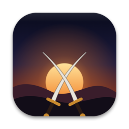
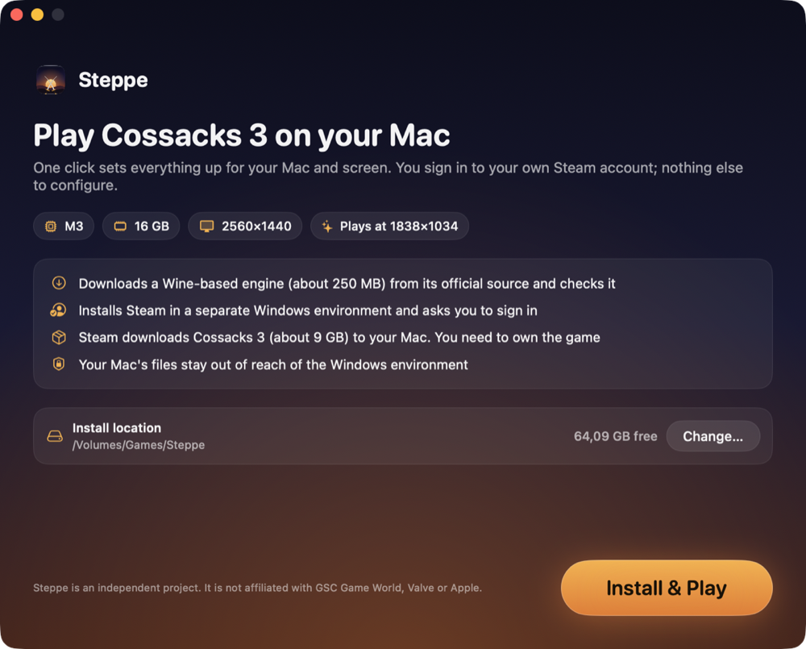
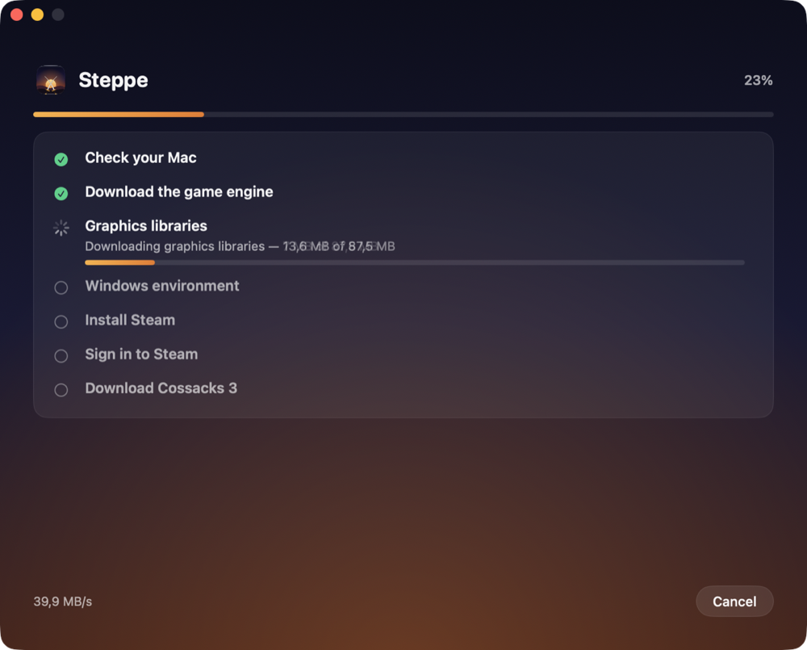
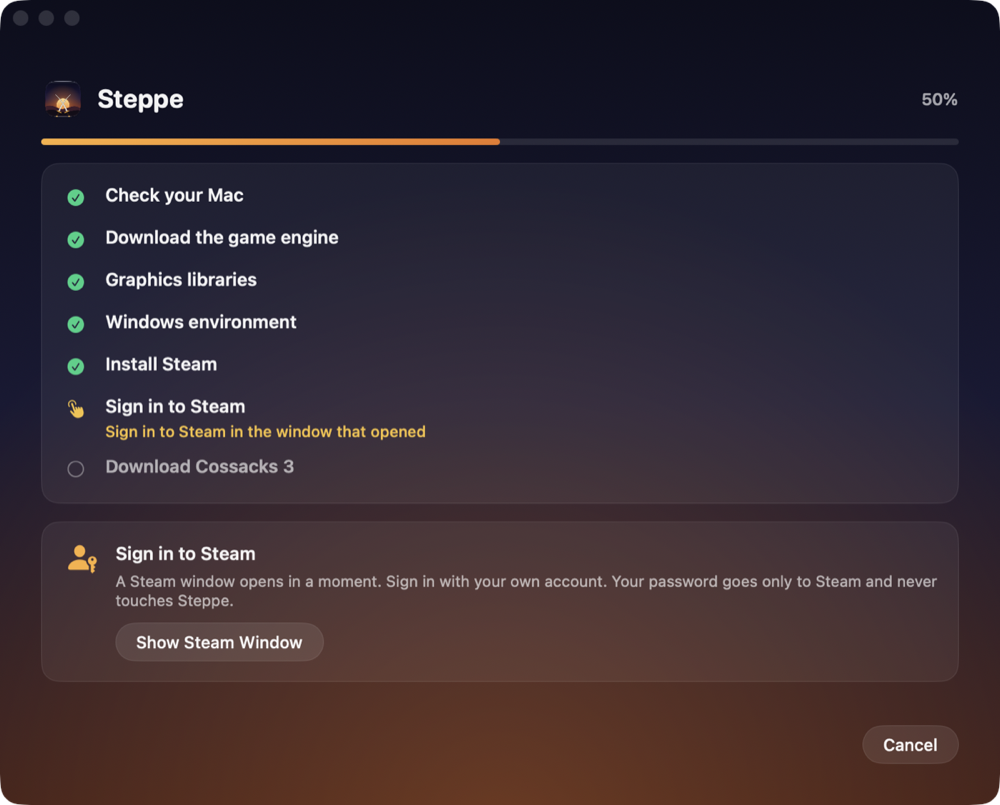

<div align="center">



# Steppe

**Play Windows strategy games on Apple silicon Macs. One click, your own Steam account.**

Starting with *Cossacks 3*.

[](https://github.com/kuarezma/steppe/actions/workflows/ci.yml)
[](LICENSE)


[Türkçe](README.tr.md) · [Download](https://github.com/kuarezma/steppe/releases/latest) · [Troubleshooting](docs/TROUBLESHOOTING.md) · [How it works](docs/ARCHITECTURE.md)

</div>

---

Cossacks 3 has no Mac version. Steppe makes the Windows version run well on an M‑series Mac **without you touching Wine, prefixes, registry keys or config files**. You press *Install & Play*, sign in to Steam in Steam's own window, and Steppe takes care of the rest: it fetches a verified Wine engine, builds an isolated Windows environment, installs Steam, lets Steam download the game, and tunes the graphics for *your* Mac and *your* screen on every launch.

It is free, open source, and built so other people (and other games) can build on it.

## Screenshots

<p align="center">
  
  
  
</p>

## What you need

- A Mac with **Apple silicon** (M1 or newer) running **macOS 14.6 or later**
- About **16 GB of free disk space** (the game itself is ~9 GB). An external disk works.
- **Cossacks 3 in your Steam library.** Steppe does not include or download the game from anywhere except Steam, using your account.
- Rosetta 2. If it is missing, Steppe offers to install it (macOS asks for your password).

## Install

1. Download `Steppe-x.y.z.dmg` from the [latest release](https://github.com/kuarezma/steppe/releases/latest) and drag **Steppe** to *Applications*.
2. Open it. macOS will say it cannot verify the developer, because Steppe is open source and **not notarized by Apple** (that requires a paid developer account). Allow it once:
   **System Settings → Privacy & Security → scroll down → “Open Anyway”.**
3. Press **Install & Play** and follow the prompts.

Prefer the terminal? This verifies the download's checksum, installs the app and clears the quarantine flag:

```bash
curl -fsSL https://raw.githubusercontent.com/kuarezma/steppe/main/Scripts/install.sh | bash
```

(Read [`Scripts/install.sh`](Scripts/install.sh) first; it is short.) Updates arrive inside the app via [Sparkle](https://sparkle-project.org); every update is signed with the project's EdDSA key, so you do not need to download anything again.

> **First launch from an external disk:** macOS asks whether Steppe may access removable volumes. Allow it; Steppe cannot store anything there otherwise.

## What happens when you press “Install & Play”

| Step | What Steppe does |
| --- | --- |
| Check your Mac | Apple silicon, macOS version, free space, Rosetta 2 |
| Engine | Downloads the Wine engine and its libraries from their official GitHub releases and **verifies pinned SHA‑256 checksums** |
| Windows environment | Creates a 64‑bit prefix; **no drive letter points at your Mac's files** and your home folders are not mapped into it |
| Steam | Downloads Valve's official installer and installs it inside that environment |
| Sign in | A Steam window opens. **You** sign in. Steppe never sees your password |
| Game | Steam downloads Cossacks 3 into the environment |
| Play | Every launch: picks a render resolution for the screen you are on, applies it, starts the game, tidies up when you quit |

## Performance, honestly

Cossacks 3 is a 32‑bit game; on a Mac its x86 code runs through Rosetta, so the CPU is the bottleneck, not the GPU. The default **Balanced** preset renders at about 1.9 megapixels (for example 1710×1112 on a 14″ MacBook Pro) and keeps shadows, SSAO and depth of field off.

- Measured on an **M3 Mac (16 GB)** with an external display scaled to 2560×1440: a heavy cavalry battle ran at roughly **27 fps** (median frame time ~35 ms, 99th percentile ~49 ms). That measurement was taken with an earlier build of these tweaks that also enabled the experimental math patches, which are now off by default; a fresh measurement of the shipping defaults is still pending. In this game the difference between “smooth” and “stuttery” is mostly frame‑time consistency, which is what Steppe optimizes.
- Other chips (M1, M2, M4, Pro/Max) and macOS versions are **not yet measured**. Please report your results; see [`docs/COMPATIBILITY.md`](docs/COMPATIBILITY.md).
- *Settings → Record frame times* writes a per‑frame log you can attach to reports.

Presets: **Performance** (~0.9 MP), **Balanced** (~1.9 MP, default), **Quality** (~3.7 MP), **Native** (your screen's full resolution). The resolution is recalculated for the display you are using each time you press Play.

## Multiplayer

Not verified. Steppe ships one optional speed‑up that changes the game's geometry math (*Settings → Advanced*). It is **off by default** because it has not been tested for lock‑step multiplayer consistency. The patches that are on (audio caching, FPS counter fix) do not touch game simulation. If you test online play, please share what you find.

## Privacy and safety

- Steppe has no analytics, no accounts and no telemetry. Its only network traffic is: GitHub (engine, libraries, updates), Valve's CDN (Steam installer) and Steam itself.
- Your Steam credentials go only to Steam's own window, inside the Windows environment.
- The Windows environment cannot see your Mac's files (no `Z:` drive, user folders are real folders inside the environment).
- *Settings → Export Diagnostics* produces a text report with your name, home folder, Steam IDs, e‑mail addresses and IPs removed.
- Downloads are checked against pinned SHA‑256 hashes before use; the patched engine file is verified byte for byte.
- The repository contains no game files and no copy of Wine; see [`THIRD_PARTY_NOTICES.md`](THIRD_PARTY_NOTICES.md).

## How it works (short)

Steppe is a SwiftUI app around a small, tested Swift core. It runs the Windows game with the official Sikarugir **Wine 10** engine under Rosetta and adds four small pieces that make it behave on modern macOS:

1. **Four documented byte patches to Wine's macOS driver** (pbuffers no longer work on current macOS; a double free; a pixel‑format query). Applied after download, verified by hash, re‑signed ad hoc. [Details](docs/ENGINE_PATCHES.md).
2. **`glfix`**: a tiny library injected into Wine that fixes shader versions, emulates pbuffers with framebuffer objects and repairs a few GL calls. [`Native/glfix`](Native/glfix)
3. **`vorbis-fast`**: audio libraries built from Xiph's sources that cache decoded sound effects and remove a startup stall. [`Native/vorbis-fast`](Native/vorbis-fast)
4. **A helper that runs inside the Windows environment** to press OK on an informational startup box, and **first‑run files** so the game does not crash on a fresh install. [`Native/dialog-helper`](Native/dialog-helper), [`GameBootstrap`](Sources/SteppeCore/GameBootstrap.swift)

Read [`docs/ARCHITECTURE.md`](docs/ARCHITECTURE.md) for the full picture.

## Build from source

```bash
git clone https://github.com/kuarezma/steppe && cd steppe
brew install mingw-w64          # builds the Windows helper DLLs
swift test                      # unit tests
Scripts/build-app.sh            # creates dist/Steppe.app (ad hoc signed)
swift run steppe-cli status     # headless developer tool
```

See [`CONTRIBUTING.md`](CONTRIBUTING.md).

## Contributing

Contributions are very welcome: testing on other Macs, performance work, translations, support for more games. The most useful thing right now is a **compatibility report** for your Mac. [`CONTRIBUTING.md`](CONTRIBUTING.md) explains the layout and how to add a language or a game.

## Legal

Steppe is an independent community project. It is **not affiliated with, endorsed by or sponsored by GSC Game World, Valve Corporation, Apple Inc. or the Wine project.** *Cossacks* is a trademark of its owners. You need your own legitimate copy of the game on Steam. Steppe contains no game assets and does not circumvent any copy protection: the game is started by the official Steam client you sign in to.

Steppe's code is MIT licensed ([`LICENSE`](LICENSE)). Wine and the other downloaded components keep their own licenses.
