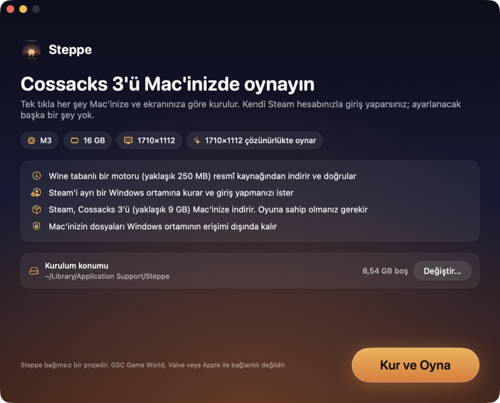
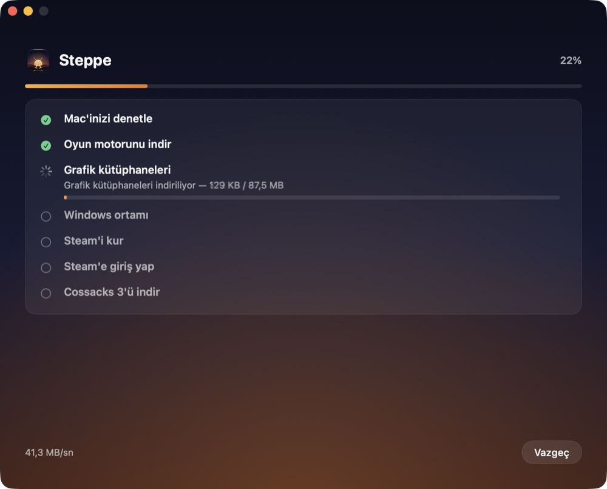
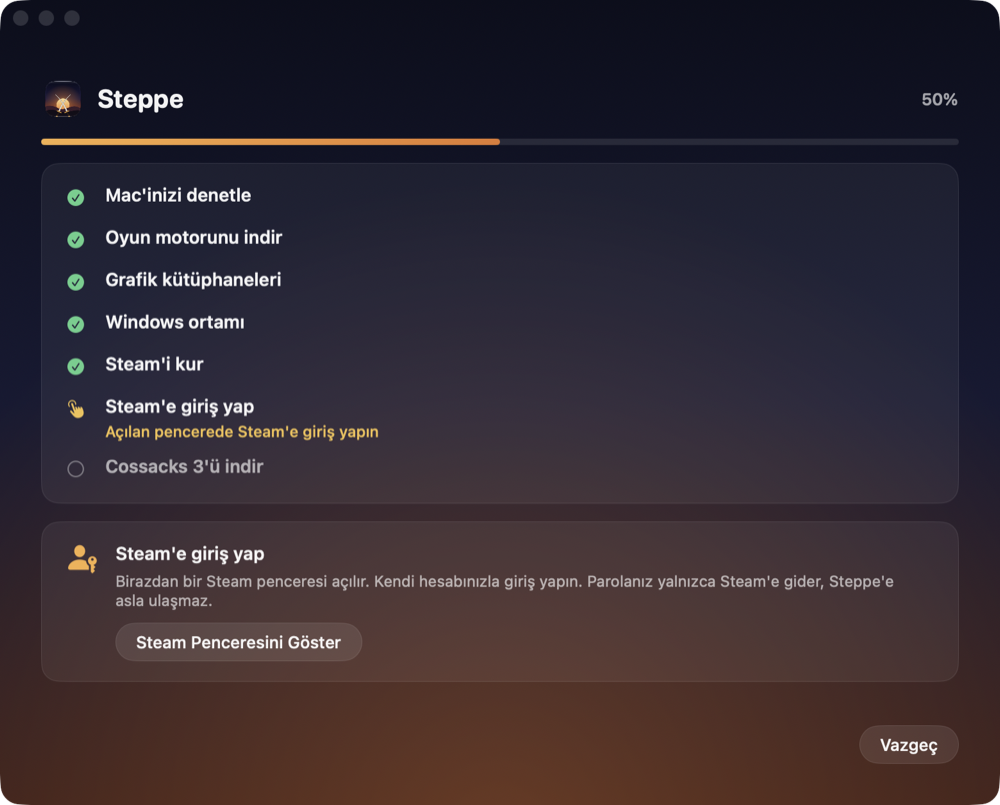

<div align="center">


# Steppe

**Windows strateji oyunlarını Apple silikonlu Mac'lerde oynayın. Tek tık, kendi Steam hesabınızla.**

İlk oyun: *Cossacks 3*.

[English](README.md) · [İndir](https://github.com/kuarezma/steppe/releases/latest) · [Sorun giderme](docs/TROUBLESHOOTING.md) · [Nasıl çalışır](docs/ARCHITECTURE.md)

</div>

---

**Cossacks 3**, PC için çıkmış klasik bir gerçek zamanlı strateji oyunudur (ordu kur, kaynak topla, savaş). Mac sürümü yok. Steppe, Windows sürümünün M serisi bir Mac'te **Wine, prefix, kayıt defteri veya yapılandırma dosyalarıyla uğraşmadan** iyi çalışmasını sağlar. *Kur ve Oyna*'ya basarsınız, Steam'e Steam'in kendi penceresinde giriş yaparsınız; gerisini Steppe halleder: doğrulanmış bir Wine motoru indirir, yalıtılmış bir Windows ortamı kurar, Steam'i yükler, oyunu Steam'e indirtir ve her açılışta grafikleri **sizin Mac'inize ve ekranınıza** göre ayarlar.

Ücretsiz, açık kaynak ve başkalarının (ve başka oyunların) üzerine geliştirebileceği şekilde tasarlandı.

## Ekran görüntüleri

<p align="center">
  
  
  
</p>

## Gerekenler

- **Apple silikonlu** (M1 veya daha yeni) ve **macOS 14.6 veya üstü** bir Mac
- Yaklaşık **16 GB boş disk alanı** (oyun tek başına ~9 GB). Harici disk de olur.
- Steam kitaplığınızda **Cossacks 3**. Steppe oyunu Steam dışında bir yerden indirmez; sizin hesabınızla Steam indirir.
- Rosetta 2. Yoksa Steppe kurmayı önerir (macOS parolanızı ister).

## Kurulum

1. [Son sürümden](https://github.com/kuarezma/steppe/releases/latest) `Steppe-x.y.z.dmg` dosyasını indirin, **Steppe**'i *Uygulamalar*'a sürükleyin.
2. Açın. macOS geliştiriciyi doğrulayamadığını söyleyecek: Steppe açık kaynaktır ve (ücretli geliştirici hesabı gerektirdiği için) **Apple tarafından noter onaylı değildir**. Bir kez izin verin:
   **Sistem Ayarları → Gizlilik ve Güvenlik → aşağı kaydırın → “Yine de Aç”.**
3. **Kur ve Oyna**'ya basın ve yönergeleri izleyin.

Terminali tercih ederseniz, bu komut indirmenin sağlama toplamını doğrular, uygulamayı kurar ve karantina işaretini kaldırır:

```bash
curl -fsSL https://raw.githubusercontent.com/kuarezma/steppe/main/Scripts/install.sh | bash
```

(Çalıştırmadan önce kısa olan [`Scripts/install.sh`](Scripts/install.sh) dosyasını okuyun.) Arayüz varsayılan olarak İngilizcedir; *Ayarlar → Dil* menüsünden Türkçe seçilebilir (macOS Türkçe ise otomatik Türkçe açılır). Güncellemeler uygulamanın içinden [Sparkle](https://sparkle-project.org) ile gelir; her güncelleme projenin EdDSA anahtarıyla imzalıdır, yeniden indirmeniz gerekmez.

> **Harici diskten ilk açılış:** macOS, Steppe'in çıkarılabilir birimlere erişip erişemeyeceğini sorar. İzin verin; aksi hâlde Steppe oraya hiçbir şey yazamaz.

## “Kur ve Oyna”ya basınca ne olur

| Adım | Steppe ne yapar |
| --- | --- |
| Mac'i denetle | Apple silikon, macOS sürümü, boş alan, Rosetta 2 |
| Motor | Wine motorunu ve kütüphanelerini resmî GitHub sürümlerinden indirir, **sabitlenmiş SHA‑256 sağlama toplamlarını doğrular** |
| Windows ortamı | 64 bit bir prefix oluşturur; **hiçbir sürücü harfi Mac'inizin dosyalarına işaret etmez**, ev klasörleriniz içine bağlanmaz |
| Steam | Valve'in resmî kurucusunu indirir ve bu ortamın içine kurar |
| Giriş | Bir Steam penceresi açılır. Giriş yapan **sizsiniz**; Steppe parolanızı asla görmez |
| Oyun | Steam, Cossacks 3'ü ortamın içine indirir |
| Oyna | Her açılışta: bulunduğunuz ekran için bir çizim çözünürlüğü seçer, uygular, oyunu başlatır, çıkınca ortalığı toplar |

## Performans, dürüstçe

Cossacks 3 32 bit bir oyundur; Mac'te x86 kodu Rosetta üzerinden çalışır, dolayısıyla darboğaz GPU değil CPU'dur. Varsayılan **Dengeli** ön ayar yaklaşık 1,9 megapiksel çizer (14″ MacBook Pro'da örneğin 1710×1112) ve gölge, SSAO ile alan derinliğini kapalı tutar.

- 2560×1440'a ölçeklenmiş harici ekranlı bir **M3 Mac'te (16 GB)** ölçüm: yoğun bir süvari savaşı kabaca **27 fps** (ortanca kare süresi ~35 ms, %99'luk dilim ~49 ms). Bu ölçüm, bu ayarların deneysel matematik yamalarını da açık tutan önceki bir sürümüyle alındı; yamalar artık varsayılan olarak kapalı ve yeni varsayılanların yeniden ölçümü henüz yapılmadı. Bu oyunda “akıcı” ile “takılan” arasındaki fark çoğunlukla kare süresi tutarlılığıdır; Steppe tam bunu iyileştirir.
- Diğer işlemciler (M1, M2, M4, Pro/Max) ve macOS sürümleri **henüz ölçülmedi**. Lütfen sonuçlarınızı bildirin: [`docs/COMPATIBILITY.md`](docs/COMPATIBILITY.md).
- *Ayarlar → Kare sürelerini kaydet* raporlara ekleyebileceğiniz kare başına günlük yazar.

Ön ayarlar: **Performans** (~0,9 MP), **Dengeli** (~1,9 MP, varsayılan), **Kalite** (~3,7 MP), **Yerel** (ekranınızın tam çözünürlüğü). Çözünürlük, Oyna'ya her bastığınızda kullandığınız ekrana göre yeniden hesaplanır.

## Çok oyunculu

Doğrulanmadı. Steppe, oyunun geometri matematiğini değiştiren isteğe bağlı bir hızlandırma içerir (*Ayarlar → Gelişmiş*). Adım adım (lock‑step) çok oyunculu tutarlılığı için sınanmadığından **varsayılan olarak kapalıdır**. Açık olan yamalar (ses önbelleği, FPS sayacı düzeltmesi) oyun simülasyonuna dokunmaz. Çevrimiçi oyunu sınarsanız bulgularınızı paylaşın.

## Gizlilik ve güvenlik

- Steppe'in analitiği, hesabı veya telemetrisi yoktur. Tek ağ trafiği: GitHub (motor, kütüphaneler, güncellemeler), Valve'in CDN'i (Steam kurucusu) ve Steam'in kendisi.
- Steam kimlik bilgileriniz yalnızca Windows ortamındaki Steam'in kendi penceresine gider.
- Windows ortamı Mac'inizin dosyalarını göremez (`Z:` sürücüsü yok, kullanıcı klasörleri ortamın içinde gerçek klasörlerdir).
- *Ayarlar → Tanılamayı Dışa Aktar*, adınız, ev klasörünüz, Steam kimlikleriniz, e‑posta adresleriniz ve IP'ler çıkarılmış bir metin raporu üretir.
- İndirmeler kullanılmadan önce sabitlenmiş SHA‑256 özetleriyle denetlenir; yamalı motor dosyası bayt bayt doğrulanır.
- Depoda oyun dosyası ve Wine kopyası yoktur; bkz. [`THIRD_PARTY_NOTICES.md`](THIRD_PARTY_NOTICES.md).

## Kısaca nasıl çalışır

Steppe, küçük ve test edilmiş bir Swift çekirdeği saran SwiftUI uygulamasıdır. Windows oyununu resmî Sikarugir **Wine 10** motoruyla Rosetta altında çalıştırır ve modern macOS'ta düzgün davranması için dört küçük parça ekler:

1. **Wine'ın macOS sürücüsüne dört belgelenmiş bayt yaması** (güncel macOS'ta pbuffer çalışmıyor; bir çift serbest bırakma; bir piksel biçimi sorgusu). İndirmeden sonra uygulanır, özetle doğrulanır, ad‑hoc yeniden imzalanır. [Ayrıntı](docs/ENGINE_PATCHES.md).
2. **`glfix`**: Wine'a enjekte edilen küçük bir kütüphane; shader sürümlerini düzeltir, pbuffer'ları framebuffer nesneleriyle taklit eder, birkaç GL çağrısını onarır. [`Native/glfix`](Native/glfix)
3. **`vorbis-fast`**: Xiph kaynaklarından derlenen, çözülmüş ses efektlerini önbelleğe alan ve açılıştaki takılmayı gideren ses kütüphaneleri. [`Native/vorbis-fast`](Native/vorbis-fast)
4. Bilgilendirici bir açılış kutusuna tamam diyen, **Windows ortamının içinde çalışan bir yardımcı** ve oyunun taze kurulumda çökmemesi için **ilk açılış dosyaları**. [`Native/dialog-helper`](Native/dialog-helper), [`GameBootstrap`](Sources/SteppeCore/GameBootstrap.swift)

Tam resim için [`docs/ARCHITECTURE.md`](docs/ARCHITECTURE.md) dosyasına bakın.

## Kaynaktan derleme

```bash
git clone https://github.com/kuarezma/steppe && cd steppe
brew install mingw-w64          # Windows yardımcı DLL'lerini derler
swift test                      # birim testleri
Scripts/build-app.sh            # dist/Steppe.app oluşturur (ad-hoc imzalı)
swift run steppe-cli status     # penceresiz geliştirici aracı
```

Bkz. [`CONTRIBUTING.md`](CONTRIBUTING.md).

## Katkı

Katkılar çok değerlidir: başka Mac'lerde test, performans çalışması, çeviriler, daha fazla oyun desteği. Şu an en yararlı şey Mac'iniz için bir **uyumluluk raporu**. [`CONTRIBUTING.md`](CONTRIBUTING.md) yapıyı, dil veya oyun eklemeyi anlatır.

## Yasal

Steppe bağımsız bir topluluk projesidir. **GSC Game World, Valve Corporation, Apple Inc. veya Wine projesiyle bağlantılı değildir, onlar tarafından onaylanmamış veya desteklenmemiştir.** *Cossacks* sahiplerinin ticari markasıdır. Steam'de kendi yasal oyun kopyanıza ihtiyacınız var. Steppe oyun varlıkları içermez ve hiçbir kopya korumasını aşmaz: oyunu giriş yaptığınız resmî Steam istemcisi başlatır.

Steppe'in kodu MIT lisanslıdır ([`LICENSE`](LICENSE)). Wine ve diğer indirilen bileşenler kendi lisanslarını korur.
